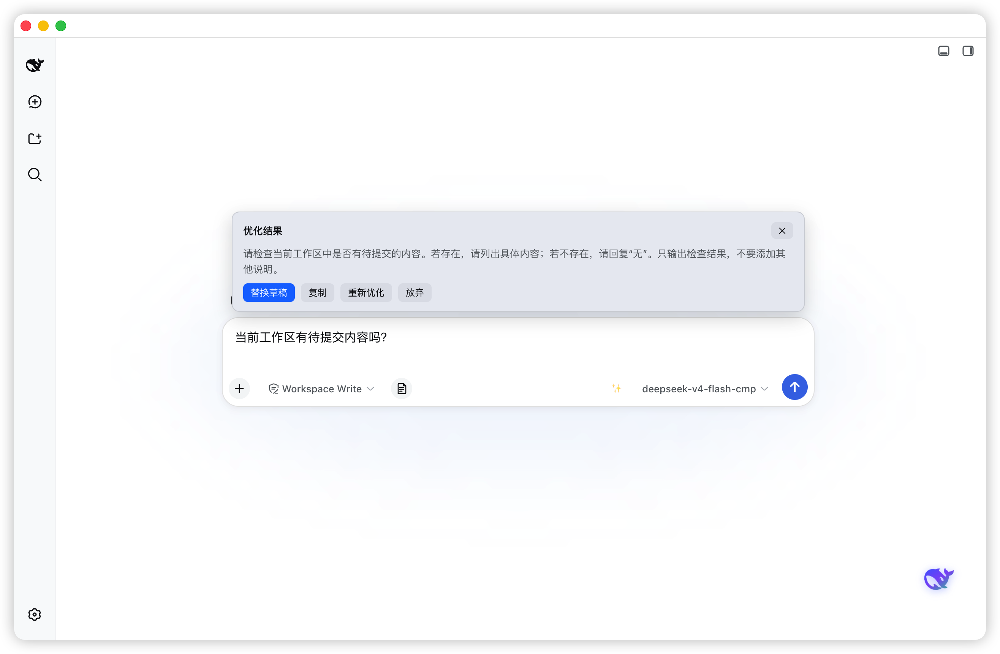

<p align="center">
  
</p>

# dsh-prompt-optimizer

[English](README.md) | 中文

[](LICENSE)
[](package.json)
[](cordis.patch.yml)

> **本仓库是 [winditer/dsh-prompt-optimizer](https://github.com/winditer/dsh-prompt-optimizer) 的衍生版本（MIT）**，提示词内核已重写：从「润色器」改为「提示词架构师 + 信息密度自适应」，并加入记忆与自学习。差异见 [CHANGELOG.md](CHANGELOG.md) 的 2.1.0 条目。

> 🤖 **AI 辅助优化**：本项目的提示词内核重写、测试与文档由 AI 辅助完成，发布前经人工审阅。详见 [AI 辅助说明](#-ai-辅助说明)。

DSH 输入框 prompt 优化插件：无需选中任何内容，直接输入草稿然后按 **✨**（或 `Alt+O`），插件会把它**重写**成一份能直接驱动模型的高质量 prompt。改写幅度**随草稿信息密度自适应**——草稿详实就精简去冗（可以比原文更短），草稿单薄才适度补齐，不套固定扩写倍数。**默认零配置**：直接经宿主服务复用当前会话模型，无需任何 API Key；也支持自配任意 OpenAI 兼容接口。

## ✨ 功能

- **一键优化**：输入栏右侧 ✨ 按钮，`Alt+O`（焦点在输入框内）等效触发
- **密度自适应改写**：先判定草稿信息密度再决定幅度——**密集型**（已含目标/范围/约束/期望输出中三项及以上）以精简去冗为主，产出可短于原文；**稀疏型**才适度补齐。四条关键信息（任务目标 / 范围 / 约束条件 / 期望输出）强制守恒，丢失任一项即判失败
- **七条铁律与反模式**：意图保真、不编造事实、量化优先、负向约束、单一产物、信息守恒等硬约束，附带「信息不足却只改措辞」「信息已足够却继续堆砌」两个反例对照
- **记忆与自学习**：采纳/否决都会被记录，每 3 次采纳自动复盘出一份偏好画像，下一轮注入 system 提示词；数据仅存本地 `localStorage`
- **真·流式预览**：经宿主 `webServer` 的 SSE 推送（`llm.stream` 每个 `text-delta` 即时到达、逐 token 呈现）；**推理过程（reasoning）先出**，等待阶段就能看到模型思考
- **零配置默认**：复用当前会话/agent 默认模型（宿主 `agentDefaultModel` + `llm` 服务），无需 API Key
- **自配接口模式**：取消「使用当前会话模型」后，可填任意 OpenAI 兼容 `/chat/completions` 端点（地址 + Key + 模型名）
- **完成操作行**：替换草稿 / 一键复制 / 重新优化 / 放弃
- **双语界面**：跟随 DSH 语言（中文 / English）实时切换，无需刷新
- **配置自持持久化**：`~/.dsh/prompt-optimizer-config.json`（loopback RPC 读写，不依赖宿主 settings 注册表）
- **深色模式**：配色跟随 DSH 主题变量，深夜模式固定品牌蓝 + 白字保证可读
- **纯本地凭据**：API Key（仅自配模式）只存本地配置文件，只发往你配置的接口

## 截图

<p align="center">
  
</p>

## 环境要求

- [DSH](https://github.com/deepseek-ai/deepseek-harness)，`web` 或 `desktop` profile
- Node.js `^22.19.0` 或 `>=24.0.0`（仅源码构建需要）
- 装入 profile 时推荐 [pnpm](https://pnpm.io)

## 📦 安装

> Bundle 入口（`id: prompt-optimizer`）由本包的 `cordis.patch.yml` 自声明，无需手工补丁文件。

### 从 GitHub 安装（推荐）

按仓库身份安装，市场即可唯一匹配到 `paper2010/dsh-prompt-optimizer`（npm 上有多个互不相关的插件共用 `dsh-prompt-optimizer` 这个名字；裸 npm 安装会让 dshmarket 无法区分，Installed 页不显示 GitHub 链接与描述）：

```sh
dsh plugin --profile desktop add github:paper2010/dsh-prompt-optimizer
```

Web profile 用 `--profile web`。安装后重启 DSH（完全退出再打开），输入栏右侧会出现 ✨ 按钮。

### 从源码安装

```sh
git clone https://github.com/paper2010/dsh-prompt-optimizer.git
cd dsh-prompt-optimizer
npm install          # 只装 esbuild（构建用，运行时零依赖）
npm run build        # 重新产出 dist/client.js
npm test             # 62 项单测 + 37 项装配冒烟
dsh plugin --profile desktop add .
```

> ⚠️ npm 名 `dsh-prompt-optimizer` 被多个互不相关的插件共用。由于 spec 不带仓库身份，dshmarket 无法区分同名条目，Installed 页不显示 GitHub 链接与描述。推荐使用上面的 `github:` 安装方式。

### 源码开发方式

```sh
git clone https://github.com/winditer/dsh-prompt-optimizer.git && cd dsh-prompt-optimizer
npm install
npm run build          # 生成 dist/client.js
dsh plugin --profile desktop add .    # 按包名把工作区 link 进 profile
```

手工安装：在目标 profile 的 `package.json`（如 `~/.dsh/profiles/desktop/package.json`）中：

```jsonc
{
  "dependencies": {
    "dsh-prompt-optimizer": "link:/absolute/path/to/dsh-prompt-optimizer"
    // ...
  },
  "dsh": {
    "profile": {
      "bundles": [ /* ... */, "dsh-prompt-optimizer" ]
    }
  }
}
```

然后在 profile 目录执行 `pnpm install` 并重启 DSH。

### 卸载

从 profile 的 `dependencies` 与 `dsh.profile.bundles` 移除 `dsh-prompt-optimizer`，清理安装目录，如不再需要可删除配置文件 `~/.dsh/prompt-optimizer-config.json`。

## 使用

- 在输入框输入草稿，点 **✨**（或 `Alt+O`）——输入区上方出现预览卡片
- 优化中：先是灰色小字实时滚动推理过程，随后重写结果逐 token 流入
- 完成：**替换草稿** 把结果写回输入框 · **复制** 复制到剪贴板 · **重新优化** 再来一次 · **放弃** 关闭
- 预览卡片绑定发起会话：切到别的会话自动隐藏，切回恢复

## 使用示例

下面是一个与插件自身无关的通用例子，用来说明它到底改什么、改成什么样。

**背景**：用户要在输入框里安排一次内部活动，但脑子里只有大概想法——时间范围、预算、参与人、要产出什么，都还没落到文字上。

**输入**（草稿）：

```
下周找个时间把新品发布会的事定一下，人得齐，预算别超
```

**预期结果**：插件把它重写成一份可以直接发出去的指令，至少补齐这四项——

| 维度 | 补齐后的内容 |
|---|---|
| 任务目标 | 确定新品发布会的时间、地点、参与人与预算方案 |
| 范围 | 只做内部筹备与排期，不涉及对外宣传物料与渠道投放 |
| 约束条件 | 时间限定在下周内；预算给出明确上限；关键角色必须到场 |
| 期望输出 | 一份含日期、地点、人员、预算的排期表，可直接审阅 |

草稿里没有的金额、具体日期不会被编造，而是写成 `<待补充：预算上限>` 这样的占位，并在末尾集中列出待确认项。

这句草稿只包含一两句意图，属于**稀疏型**，所以插件以补齐为主；同样的话题如果已经写清了上面四项，它会反过来做精简——删重复、压篇幅，结果可能比原文更短。

## ⚙️ 配置

打开 **设置 → 通用设置 → Prompt 优化**：

| 设置项 | 默认 | 说明 |
| --- | --- | --- |
| 使用当前会话模型 | 开 | 复用会话/agent 默认模型（零配置）。关闭后启用下列字段 |
| 接口地址 | `https://api.deepseek.com` | 任意 OpenAI 兼容 `/chat/completions` 端点 |
| API Key | — | 自配模式的密钥（跟随模式忽略） |
| 模型名 | `deepseek-v4-flash` | 模型名（跟随模式忽略） |

配置保存于 `~/.dsh/prompt-optimizer-config.json`（与 DSH 其他配置同目录，卸载插件时一并清理）。

> 自配接口需支持 CORS 与 SSE 流式（官方 DeepSeek / OneAPI 类网关均可）。

## 🏗️ 架构

一个包、两半：

- **server half**（`lib/index.js`）：经 loopback RPC 通道（`/dsh-prompt-optimizer`，`get`/`set`）持久化配置；并经宿主 `webServer` 服务注册 HTTP JSON API（`/dsh-prompt-optimizer/api`）。经 `llm.stream` 跑会话默认优化；后台流存于内存 `Map`，插件卸载即清。
- **client half**（`src/*.ts`，esbuild 打包为 `dist/client.js`，包 `__ModuleLoader__.load({ id: "dsh-prompt-optimizer", … })`——id **必须等于**安装包名）。渲染进 `conversation.input.right`（按钮）、`conversation.input.overlay`（预览卡）与 `settings.general.item`（设置行）；与 host 用 `fetch` POST 通信。

### Host API

全部为 `POST /dsh-prompt-optimizer/api/<method>`；响应均为 `{ ok: true, value }` 或 `{ ok: false, error }`。

| 方法 | Body | 返回 |
| --- | --- | --- |
| `sessionModel` | `{}` | `{ provider, model, reasoningEffort? }` — 会话默认模型 |
| `optimize.stream` | `{ provider, model, text, system?, reasoningEffort? }` | `text/event-stream` — 先 `event: reasoning` 帧，再逐 token `event: delta`，结束 `event: done` |
| `optimize.start` | `{ provider, model, text, system?, reasoningEffort? }` | `{ taskId }` — 后台累积（降级路径） |
| `optimize.poll` | `{ taskId }` | `{ done, text, error? }` — 流式过程中的累积文本 |
| `optimize.abort` | `{ taskId }` | `{ ok }` |

协议细节：仅接受 `POST`（否则 405）；body 为 JSON，上限 1 MB；未知方法返回 404。

## 🔒 安全说明

- **默认通道不发送任何凭据**——直接复用 harness 配置的 provider。
- **自配模式的 API Key 只留本地**（`~/.dsh/prompt-optimizer-config.json`），只发往你配置的接口。
- 优化内容只出现在预览卡片；只有按 **替换草稿** 才会写入会话。

## 🔧 开发

```sh
npm run build   # esbuild：src/index.ts → dist/client.js（__ModuleLoader__ bundle）
npm test        # node 运行 tests/entry.ts（状态机、通道、SSE 解析）
```

### 目录结构

```
src/index.ts          客户端入口 — 槽位接续、RPC/配置胶水、宿主探针
src/OptimizeButton.tsx / PreviewCard.tsx / SettingsRow.tsx
src/optimizer.ts      配置默认值、系统提示词、OpenAI 兼容 fetch/SSE 客户端
src/session-optimizer.ts  宿主通道：sessionModel + SSE 流 + 降级轮询
src/preview-state.ts  预览卡片状态机（纯 reducer）
src/preview-bus.ts    模块级事件总线（按钮/卡片/编排共享）
lib/index.js          server half — 配置持久化 + HTTP JSON API（makeHandler + createApiRoute）
dist/client.js        构建产物（__ModuleLoader__ 格式，load id = dsh-prompt-optimizer）
cordis.patch.yml      bundle 入口声明（insert: { id: prompt-optimizer, name: dsh-prompt-optimizer }）
scripts/build.mjs     构建脚本（esbuild + bundle 包装）
tests/entry.ts        单元 + 集成测试（61）
assets/               截图
```

### 踩过的坑

- **Bundle id 必须等于包名**——否则 `arrive()` 抛 `bundle loaded without registering <id>`。`scripts/build.mjs` 写死了正确 id。
- **Profile bundle 拿不到 cordis `timer` 服务**——用浏览器原生 `setInterval`/`setTimeout`（在 React effect 清理中释放），与姊妹包 `dsh-elf` 一致。
- **不要用 `session.create/fork` 做生成**——后台会话不会执行（渲染进程自编 id 被静默拒绝、fork 子会话不在前台不触发模型），实测表现是「永远正在优化」。改为由 server half 经 `llm.stream` 驱动模型。
- **不要把流式协议跑在 `connection.rpc.call` 上**——desktop 渲染进程的 rpc.call 在同一流程**第二次调用挂死**（实测 `sessionModel` 成功、下一次调用永不达）。宿主通道走 HTTP（`webServer`）。
- **优先 `link:` 而非 `file:`** 安装工作区副本——`file:` 是拷贝，改动/重构建后会过期。
- **client 改动刷新即生效；host（lib）改动需完整重启 DSH。**
- **构建脚本坏了会静默保留旧 bundle**——`npm run build` 必须打印 `✓ Built`；若只打印 Node 版本号就是脚本失败（曾有一次回归留下看起来「最新」的过期 `dist/client.js`）。
- **新发布可能触发 profile 的 `minimumReleaseAge` 策略**——若 profile 启用了 pnpm 的上架时效检查，发布于 ~24 小时内的版本执行 `dsh plugin … add <pkg>` 会报 `ERR_PNPM_MINIMUM_RELEASE_AGE_VIOLATION`。把精确的 `name@version` 加进 profile 的 `pnpm-workspace.yaml` 的 `minimumReleaseAgeExclude`（每次发新版本记得更新）：

  ```yaml
  minimumReleaseAgeExclude:
    - dsh-prompt-optimizer@2.0.0
  ```

## 🤖 AI 辅助说明

- **AI 参与范围**：提示词内核（`src/optimizer.ts`）、记忆与自学习（`src/memory.ts`）、测试（`tests/`）、构建脚本与本文档，均在 AI 辅助下完成与优化。
- **人工把关**：需求与行为边界由人工确定；全部改动经人工审阅，测试在本地与 CI 实跑通过后才发布。
- **标注位置（全文措辞一致）**：
  - 页首提示与本节的 README 标注
  - 源文件头注释：`src/index.ts`、`src/optimizer.ts`、`src/memory.ts`、`lib/index.js`、`scripts/build.mjs`
  - 插件设置页常驻提示：文案键 `settings.aiNotice`
- **统一措辞**：中文用「AI 辅助优化」，英文用「AI-assisted」；不使用「AI 生成」「全自动」这类说法——既不夸大 AI 的作用，也不掩盖人工审阅这一环。

## 📄 License

[MIT](LICENSE)